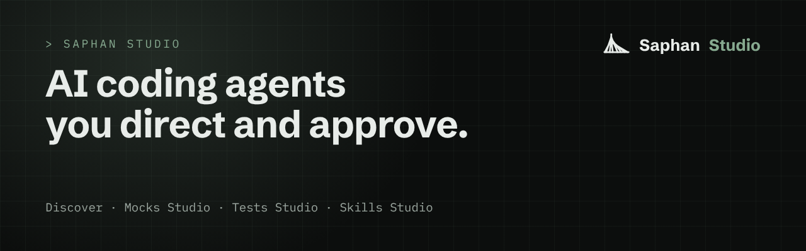

## Saphan Studio

**A fleet of AI coding agents that you direct and approve.** You say what you want. Agents plan, build and review it, a
reviewer from a different AI company checks every step, and nothing is accepted without you. Every order, review and
decision is written down.

### Start here

- **[QuakeWatch server](https://github.com/saphan-ai/quake-watch-server)**: your first app with Saphan Studio, built and
  explained step by step. The [Android](https://github.com/saphan-ai/quake-watch-android) and
  [iPhone](https://github.com/saphan-ai/quake-watch-ios) apps follow.
- **[Proven](https://github.com/saphan-ai/proven)**: an open-source code reviewer that reports only what it can prove, built by
  the fleet in six days for the Open Agent Hackathon 2026.

### The open parts of Saphan Studio

Agents need more than a model. They need to understand the code they work on, systems to practise on without touching the real
ones, tests that prove something, and instructions you can trust. Each of these has an open part anyone can use without Saphan Studio:

- **[Discover](https://github.com/saphan-ai/discover)**: reads a repository **without changing it** and proves afterwards that
  it changed nothing. It is the first step before any agent touches code it did not write.
- **[Mocks Studio](https://github.com/saphan-ai/mocks-studio)**: free mock systems (mail, file storage, a user directory,
  Kubernetes and more) that agents, tests and skills can work against **instead of the real thing**, with an open standard
  and a conformance suite for writing your own.
- **[Tests Studio](https://github.com/saphan-ai/tests-studio)**: an open standard for reporting a test run from **the framework
  you already use**, so results from different tools can be collected, compared and trusted.
- **[Skills Studio](https://github.com/saphan-ai/skills-studio)**: an open format for agent skills, with a fingerprint and a
  signature you can check offline. **Trust the instructions your agents follow, and be able to show why.**

Each repository says what works today and what is still being built.

[saphan.ai](https://saphan.ai) · [docs.saphan.ai](https://docs.saphan.ai)
